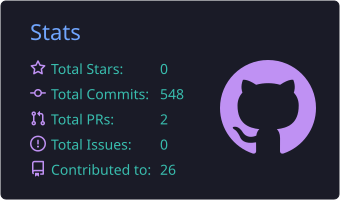
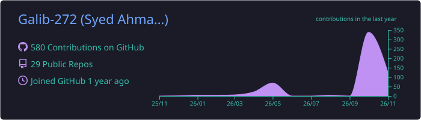
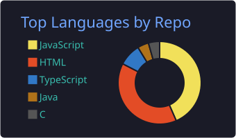

  

  

  

    
    
    
  

  <samp>
    <h3>👋 Welcome to my digital workspace!</h3>
    <b>Building production-ready full-stack web apps, from the database up to the last pixel.</b>
     
    Let's collaborate! Feel free to connect or reach out.
  </samp>

---

# 👋 Hi, I'm **Syed Ahmad Galib**

🎓 Computer Science & Engineering student at **Daffodil International University**  
💼 **Full-stack Web Developer (React & Next.js)** | Open to **Internship, Junior, Part-time, Hybrid & Full-time roles**

I build **production-ready, responsive web applications** with React, Next.js, Node.js and MongoDB, with a strong focus on
**clean code, performance and user experience**. I enjoy learning fast, collaborating, and turning ideas into reliable features.

---

## 🚀 Quick Overview

<table align="center" width="100%" border="0">
  <tr>
    <td width="55%" valign="top">
      <ul>
        <li>🔭 <b>Focus:</b> Real-world full-stack apps with React, Next.js and TypeScript</li>
        <li>🌱 <b>Learning:</b> Advanced backend integrations, real-time features and smooth animations</li>
        <li>🏅 <b>Certified:</b> Complete Web Development (Programming Hero, with Excellence) · Web Development Essentials (EDGE, BCC)</li>
        <li>⚡ <b>Goal:</b> Becoming a highly adaptive industry software engineer</li>
      </ul>
    </td>
    <td width="45%" valign="top" align="center">
      
    </td>
  </tr>
</table>

---

## 🛠️ Tech Stack

<b>Frontend</b>

  

<b>Backend & Database</b>

  

---

## 🧰 Tools & Workflow

  

  Branching · Pull Requests · Clean Commits · CI-friendly workflow

---

## 📊 GitHub Activity

  

  
  

---

## 📈 GitHub Contributions

  

---

## 🏗️ Featured Projects

<table align="center" border="0">
  <tr>
    <td><b>🍽️ <a href="https://savoria-client-side.vercel.app/">Savoria</a></b></td>
    <td>Restaurant management system: role-based dashboards, POS & payments, reservations, real-time notifications. <i>Next.js · TypeScript · MongoDB · Socket.IO</i></td>
  </tr>
  <tr>
    <td><b>🎫 <a href="https://ticketbari-client-side.vercel.app/">TicketBari</a></b></td>
    <td>Online ticket booking platform: travel search, booking, vendor management, payments, admin analytics. <i>Next.js · Express.js · MongoDB · JWT</i></td>
  </tr>
  <tr>
    <td><b>💡 <a href="https://assignment-9-client-side.vercel.app/">IdeaVault</a></b></td>
    <td>Startup idea validation platform: submit concepts, gather structured peer feedback, refine ideas together. <i>Next.js · Tailwind CSS · REST API</i></td>
  </tr>
</table>

---

## 🤝 Connect & Collaborate

   &nbsp;&nbsp;
   &nbsp;&nbsp;
  

